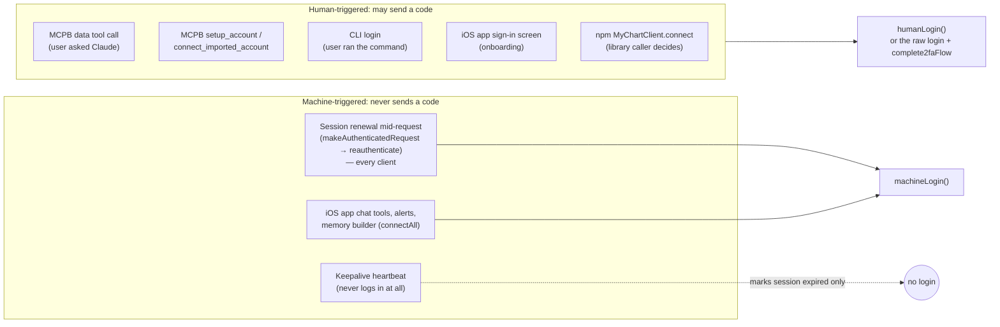
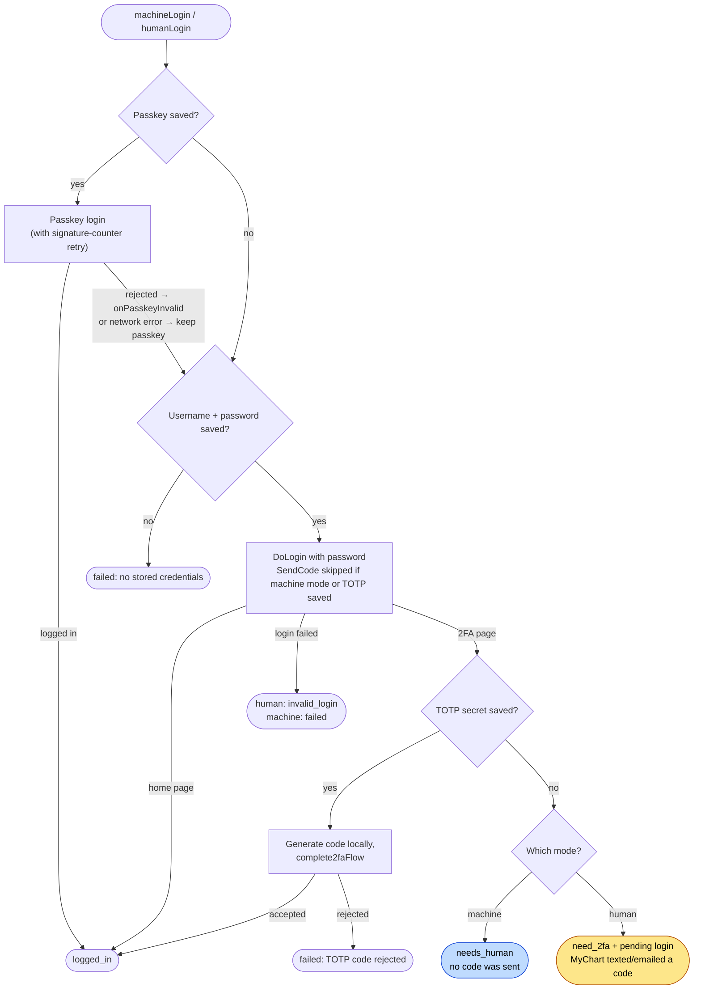
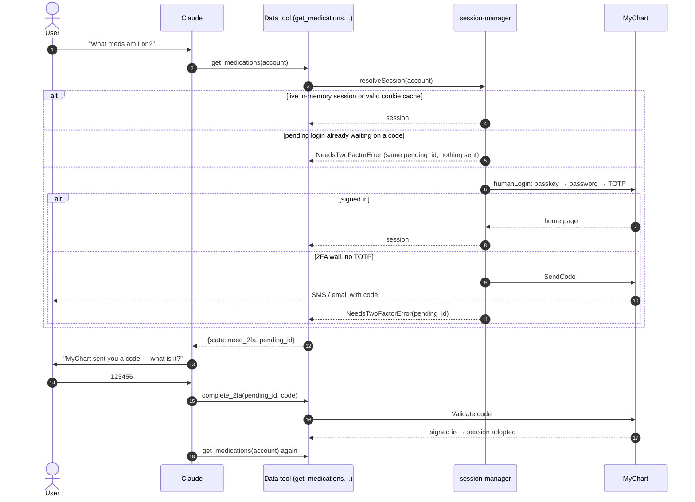
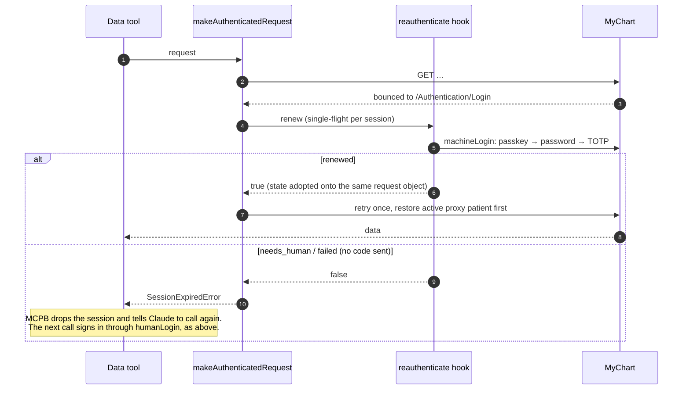

# Login modes: machine vs human

Every sign-in with stored credentials goes through one of two functions in
[`scrapers/myChart/auth/loginModes.ts`](../scrapers/myChart/auth/loginModes.ts):

| | `machineLogin` | `humanLogin` |
| --- | --- | --- |
| Who asked | Nobody — a renewal, a background job | A person, directly or through Claude |
| Can make MyChart text/email a code | **Never** | Yes, when nothing stored gets past 2FA |
| Outcomes | `logged_in` · `needs_human` · `failed` | `logged_in` · `need_2fa` (+ pending login) · `invalid_login` · `failed` |

**The rule:** a code may only be sent by a caller that keeps the pending login and can accept the
code afterwards. A renewal hook can't: it runs inside a request, with no way to ask anyone for a
code, so a code it sent could never be used. It would also send a fresh one on every expiry.

They are two functions rather than a flag, so a background caller can't pick the wrong mode by
accident.

## Who triggers what

A tool call is **human-triggered**: the user asked Claude, and Claude called the tool. Claude can
relay the code back through `complete_2fa`. Mid-request renewal is **machine** even inside a
human-triggered tool call, because nothing can collect a code there.

The iOS app's chat is human-triggered by the definition above. It uses machine mode only because
the app has nowhere outside onboarding to type a code. A code sent from chat would be one nobody
could enter.

## The shared ladder

Both modes climb the same ladder. They differ at one step: what happens at a 2FA wall when no TOTP
secret is stored.

## Desktop extension (MCPB): a data tool call

Concurrent tool calls share one sign-in (the per-account login lock), and while a pending login
is unexpired (10 minutes) every call hands back its `pending_id` instead of sending another code.

## Session expiry in the middle of a call

## What each client does

| Client | Human path | Machine path |
| --- | --- | --- |
| Desktop extension | `setup_account`, `connect_imported_account`, and the lazy sign-in behind every data tool (`humanLogin`) → `complete_2fa` | `reauthenticate` hook → `machineLogin` |
| CLI | `login()` in `npm-package/cli/cli.ts`: prompts for the code (or `--2fa`, or a saved TOTP) | `wireCliSessionRenewal` → `machineLogin` |
| iOS app | `connectAccount` (onboarding) → `humanLogin` → twofa step → `complete2fa` | `connectAll` / `requireSession` (chat, alerts, memory) and the `reauthenticate` hook → `machineLogin` |
| npm library | `MyChartClient.connect` returns `need_2fa` with `complete(code)`; `skipSendCode` is the caller's choice | `wireSilentReauthentication` → `machineLogin` |

## Unverified

The design assumes MyChart sends a code only when `SendCode` is called. The 2FA page offers
"email me" / "text me" buttons, which suggests it does, but it has not been confirmed on a real
account. To check: sign in with `machineLogin` to an account that has 2FA and no TOTP, and confirm
that no text or email arrives.
