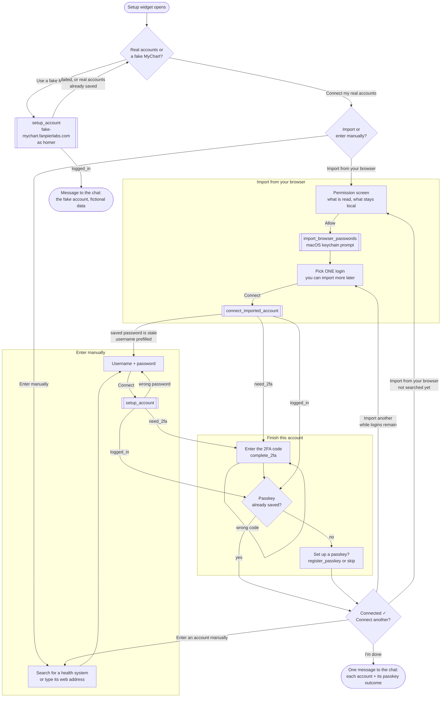

# MCPB setup widget: user flow

How a user connects MyChart accounts through the Claude Desktop extension's setup widget
(`get_setup_widget`, a React app in [`claude-desktop-extension/src/setup-widget/`](../claude-desktop-extension/src/setup-widget/);
the flow below is the reducer in `flow.ts`).

The first screen asks whether to connect **real MyChart accounts** or **use a fake MyChart**.
The fake one signs in to `fake-mychart.fanpierlabs.com` as its no-2FA test patient in one click
and ends the widget, skipping everything below.

**Rule: the fake MyChart and real accounts are never connected together.** Either the demo is
saved or one or more real accounts are, never both. `claude-desktop-extension/src/demo-account.ts`
enforces it wherever a login is saved (`setup_account`, `connect_imported_account`,
`complete_2fa`). Connecting a real account deletes the demo login. The demo is refused while
any real account is saved, because making room would delete the user's real logins and passkeys,
so that only happens if the user disconnects them.

Real accounts are connected **one at a time**. Nearly every portal asks for a 2FA code, so each
account runs to the end (sign-in, code, passkey offer) before the widget asks about the
next one. After every account the user lands on the same list, which offers another
import (while any are left), a manual sign-in, or **I'm done**.

## Notes

- **Back buttons.** *Back* on the import-or-manual choice returns to the real-or-fake screen. From 2FA on an imported login, *Back* returns to the list (the pending
  login is dropped); on a manual login it returns to the username/password step. The
  sign-in step reached from a stale import goes back to the list, not the health-system search.
- **What the list offers.** A login connected in this widget leaves the list (it moves to the
  ✓ list above it). One already connected before, or saved without a username, is shown but
  can't be picked. When nothing pickable is left, the list disappears and **I'm done**
  becomes the main button.
- **Import ids expire** 10 minutes after the scan. If a long round of 2FA codes outlasts
  them, the list says so and offers *Import from your browser* again.
- **Passwords never reach the widget or Claude.** The widget handles only opaque import ids;
  `connect_imported_account` redeems one inside the server process.
- **Leaving the chat and coming back.** Claude Desktop tears the widget down when the user
  switches away and remounts it on return. `get_setup_widget` stamps its result with a
  `view_id`, the host hands that same result to every remount, and the widget saves its state
  to `localStorage` under it, so it reopens on the page it was on. A step that was waiting on a
  call (connecting a login, the demo) reopens where that call was made.
- **Slow calls.** A call that outruns Claude Desktop's timeout comes back parked; the widget
  waits it out with `check_pending_call` (most likely the scan, sitting on the keychain prompt).
